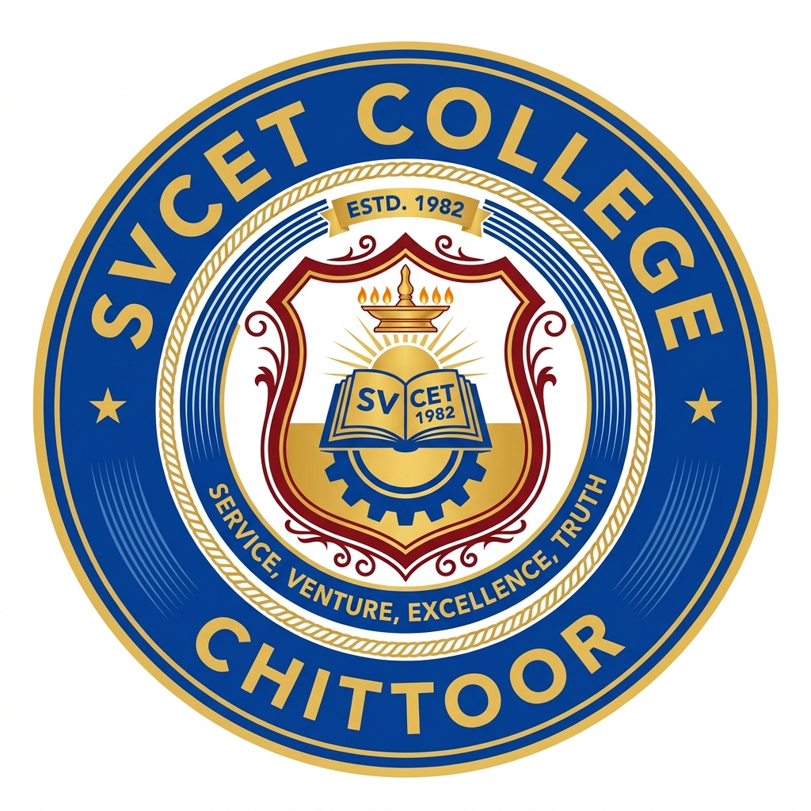
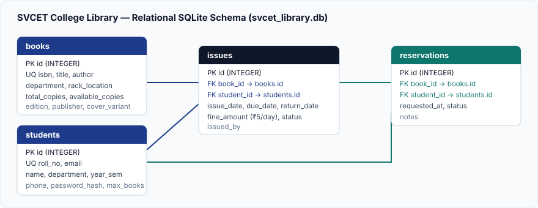

<div align="center">
  
  <h1>SVCET College Library Management System</h1>
  <p>
    <strong>Sri Venkateswara College of Engineering &amp; Technology (Autonomous), Chittoor</strong><br />
    Full-stack Library Management System built with <strong>Python (Flask + sqlite3)</strong>, <strong>SQLite (SQL)</strong>, <strong>React</strong>, <strong>TypeScript</strong>, and <strong>Express</strong>.
  </p>
</div>

<p align="center">
  
</p>

## Overview

This project provides a unified web portal with separate **Student** and **Admin** interfaces backed by a normalized relational SQLite database (`svcet_library.db`).

### Key Features

- **Student Portal (Sign Up & Login)**
  - Students register with Full Name, Roll Number, Department, Year & Semester, College Email, Phone Number, and Password (`scrypt` salted hash).
  - Browse real-time **Available Books** across departments (`CSE`, `AI & DS`, `ECE`, `EEE`, `MECH`, `CIVIL`, `MBA`) with live copy counts and rack locations.
  - Submit pickup reservations, monitor active borrowings, check due dates, and view late return fines (`₹5/day`).
- **Admin Portal (Librarian Console)**
  - Protected administrator login to manage textbook inventory (add titles, update copy counts, remove unissued books).
  - Issue and return books using atomic SQL transactions that update shelf inventory automatically.
  - Approve or decline pending student reservations, inspect registered students, and run read-only `SELECT` / `PRAGMA` queries in the built-in **SQL Explorer**.
- **Python & SQL Backend**
  - Includes a standalone Python Flask + `sqlite3` server (`svcet_library.py`) and `schema.sql` using the exact same SQLite schema.

---

## Visual Assets & Database Architecture

<table>
  <tr>
    <td align="center" width="50%">
      <br />
      <sub><b>Computer Science &amp; AI Catalog</b></sub>
    </td>
    <td align="center" width="50%">
      <br />
      <sub><b>ECE, EEE &amp; Core Engineering Catalog</b></sub>
    </td>
  </tr>
</table>

### Relational SQL Schema

<p align="center">
  
</p>

---

## Project Structure

```text
svcet-college-library/
├── docs/
│   └── er-diagram.svg      # Relational SQLite database diagram
├── src/
│   ├── assets/images/      # SVCET Chittoor logo, banner, and textbook covers
│   ├── components/         # Student & Admin login, signup, and portal views
│   ├── db/                 # SQLite initialization and Python/SQL templates
│   ├── types/              # TypeScript interfaces
│   └── App.tsx             # Main portal shell
├── server.ts               # Express + SQLite REST API & Vite dev server
├── svcet_library.py        # Python Flask + sqlite3 backend
├── schema.sql              # SQLite relational table definitions
├── requirements.txt        # Python dependencies
└── package.json            # Node & frontend dependencies
```

---

## How to Run Locally

### Option 1: Run the Full-Stack Web App (Recommended)

**Prerequisites:** Node.js 18+ installed.

```bash
# 1. Install dependencies
npm install

# 2. Configure environment variables (optional)
cp .env.example .env

# 3. Start the application
npm run dev
```

Open **http://localhost:3000** in your browser.

### Option 2: Run the Python + SQLite Backend

**Prerequisites:** Python 3.10+ installed.

```bash
# 1. Install Flask
pip install -r requirements.txt

# 2. Initialize the SQLite database schema
sqlite3 svcet_library.db < schema.sql

# 3. Start the Python API server
python svcet_library.py
```

---

## Environment Variables

Copy `.env.example` to `.env` before deploying:

```env
PORT=3000
ADMIN_LIBRARY_PASSWORD="your_admin_password"
```
